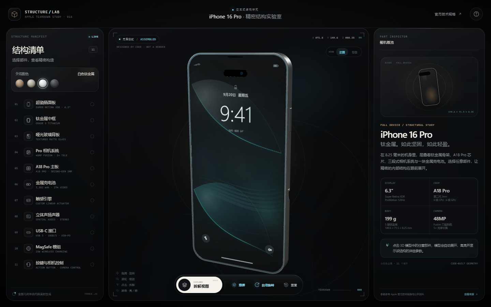
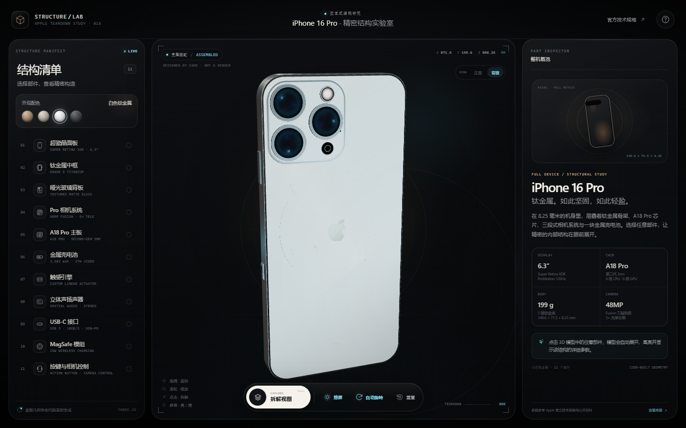
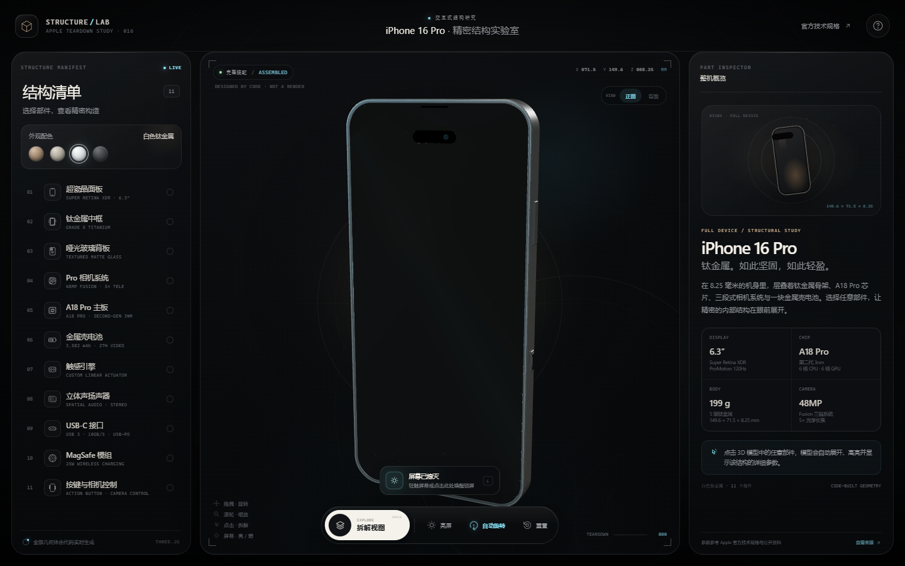
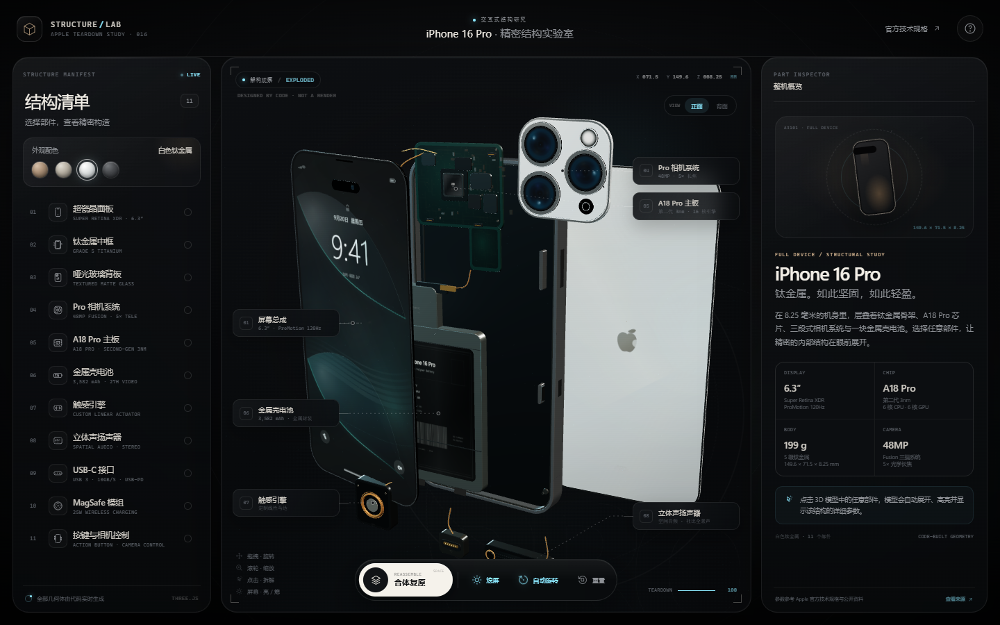

# iPhone 16 Pro · 精密结构实验室

一个使用 **Three.js + HTML + CSS + JavaScript** 构建的 iPhone 16 Pro 交互式 3D 拆解可视化页面。

> 本页面为原理性、非官方概念演示。所有产品名称与参数仅用于学习与展示，参数以 Apple 官方页面为准。默认外观按参考真机图呈现为白色钛金属，可在页面中切换其他钛金属配色。






更多视觉预览（相机模组聚焦、移动端）位于 `previews/`。

## 直接运行

页面没有构建步骤，也不依赖网络字体或外部 3D 文件。

- **方式一：直接打开** `index.html`
- **方式二：本地静态服务器**

```bash
node server.js
```

然后访问 `http://127.0.0.1:4173/`。

需要支持 WebGL 的现代浏览器（Chrome / Edge / Safari / Firefox），建议开启硬件加速以获得最佳帧率。

## 交互说明

| 操作 | 效果 |
| --- | --- |
| 拖拽 | 自由旋转视角 |
| 滚轮 / 双指 | 缩放视角 |
| 点击 3D 部件 | 触发逐层拆解，并聚焦、高亮该部件 |
| 点击熄灭的屏幕 | 点亮屏幕，显示锁屏壁纸与时间 |
| 「熄屏 / 亮屏」 | 控制屏幕电源，观看锁屏亮起或熄灭 |
| 左侧结构清单 / 移动端横向部件条 | 选择任意部件 |
| 「拆解视图 / 合体复原」 | 展开全部 11 个部件或重新装配 |
| 正面 / 背面 | 快速切换整机观察角度 |
| 外观配色 | 切换沙漠色、自然色、白色、黑色钛金属（默认白色） |
| `Space` | 拆解 / 复原 |
| `L` | 亮屏 / 熄屏 |
| `A` | 自动旋转 |
| `R` | 重置视角 |
| `Esc` | 取消选中 / 关闭面板 |

在移动端，点击部件会打开底部详情面板；收起面板后可继续旋转、缩放、观察高亮部件，再次点击底栏「详情」可重新打开。屏幕熄灭时，轻触手机正面即可唤醒锁屏。

## 功能亮点

- **纯代码程序化建模**：机身、超瓷晶面板、超视网膜 XDR 屏幕、钛金属中框、哑光玻璃背板、Pro 三摄模组、A18 Pro 主板、金属壳电池、Taptic Engine、立体声扬声器、USB-C 接口、MagSafe 线圈和全部按键均由 Three.js 几何体组合生成。
- **Pro 相机模组重制**：参照 Apple 官方机身图与相机特写，将相机岛整体贴近背板顶部边框；三颗大尺寸镜片、加宽金属镜圈、闪光灯、LiDAR 与麦克风均按真机排列，磨砂相机岛与机身过渡更自然。
- **程序化锁屏壁纸**：锁屏壁纸、镜头镜片、Apple 标志、A18 Pro 芯片、PCB 走线、电池标签、扬声器格栅等均由 Canvas 2D 实时绘制，不使用外部图片。壁纸以深色 OLED 为底，叠加青绿色玻璃叶片与冷银高光，呼应参考图中的蓝绿色屏幕。
- **屏幕亮灭动画**：点亮时显示完整的 iOS 风格锁屏（日期、时间、天气、快捷控件、状态栏和 Home 指示条），同时通过屏幕材质亮度、短暂过曝和机身前的点光源完成唤醒过渡；熄灭时移除屏幕纹理，仅保留玻璃反射与黑色面板。
- **分层拆解动画**：11 个部件以错峰方式展开；相机模组与背板在拆解过程中绕自身中心翻转，展示镜头和外侧玻璃。
- **聚焦检视**：点击部件后，模型将部件居中、拉近、描边，并将其他结构渐隐为环境参考，配合参数面板展示详情。
- **可旋转标签**：拆解状态下会显示 6 个主要部件的引线标注，并随相机实时重新投影和避让。
- **深色科技视觉**：动态背景光晕、网格、粒子、扫描线、发光焦点与低饱和钛金属材质共同构成视觉系统。
- **完整响应式布局**：桌面三栏 → 平板双栏 → 移动端单栏 + 底部详情抽屉。
- **可访问性**：键盘快捷键、原生帮助 Dialog、按钮焦点态、`prefers-reduced-motion` 适配、WebGL 失败回退。

## 文件结构

```text
.
├── index.html               # 页面结构与 SVG 图标
├── css/
│   └── style.css            # 视觉系统、响应式布局与动效
├── js/
│   ├── model.js             # 程序化几何、程序化纹理、部件数据
│   └── app.js               # Three.js 场景、相机、交互、界面状态
├── vendor/
│   ├── three.min.js         # Three.js r160（本地，无需 CDN）
│   └── three.LICENSE         # Three.js 许可证
├── previews/                # 预览图（页面运行不依赖）
├── server.js                # 可选：零依赖本地静态服务器
└── README.md
```

## 技术说明

- Three.js 以本地 `vendor/three.min.js` 引入，不依赖 CDN，也不会请求外部 3D 模型或贴图。
- 所有 UI 图标均为内联 SVG；屏幕、芯片、电池和镜头纹理均通过 Canvas 生成。
- 使用自定义轨道相机逻辑，支持惯性阻尼、远近限制、双指缩放、点击拾取与选中部件优先拾取。
- 锁屏亮灭不是单独的视频或贴图切换：屏幕材质的颜色、显示纹理的挂载与移除、唤醒过曝以及挂在屏幕组下的点光源共同完成过渡，熄灭后显示平面仍保留用于点击唤醒。
- 高亮由屏幕空间 Reticle、边缘线框、自发光微调和环境参考渐隐构成；没有使用后处理依赖。
- 所有内部部件都有独立材质组，支持逐部件透明度、自发光和描边的实时动画。
- 布局适配 `100dvh` 与安全区域，桌面、平板、手机分别采用不同的面板与标注策略。

## 参数来源

- [Apple 支持：iPhone 16 Pro 技术规格](https://support.apple.com/zh-cn/121031)
- [Apple 支持：iPhone 16 Pro 内部视图、可订购部件与爆炸图](https://support.apple.com/en-mt/120805)

电池典型容量等部分数值来自公开资料整理，页面中已标注「参考」。内部堆叠、部件位置和标注线为便于观察而进行了可视化重排，并非维修级尺寸图纸。

---

由 Three.js 程序化构建 · 仅供学习与展示。
